# School Management Activity Diagram

This activity diagram summarizes the main end-to-end workflow of the School Management project: login, role-based routing, platform administration, school administration, teacher operations, student/parent portals, and backend persistence.

```mermaid
flowchart TD
    Start([Start]) --> OpenApp[Open React SPA]
    OpenApp --> Login[Enter email, password, and optional school]
    Login --> AuthApi[POST /api/v1/Auth/login]
    AuthApi --> ValidateCredentials{Credentials valid?}

    ValidateCredentials -- No --> LoginError[Show login error]
    LoginError --> Login

    ValidateCredentials -- Yes --> IssueTokens[Issue access token, refresh token, role, permissions]
    IssueTokens --> StoreSession[Store auth session in frontend]
    StoreSession --> RoleDecision{User role}

    RoleDecision -- Platform Admin --> P1
    RoleDecision -- School Admin --> S1
    RoleDecision -- Teacher --> T1
    RoleDecision -- Student --> ST1
    RoleDecision -- Parent --> PR1

    subgraph PlatformFlow[Platform admin activities]
        P1[View platform dashboard and analytics]
        P2[Create or update school]
        P3[Register school admin]
        P4[Manage subscription plans, invoices, and payments]
        P1 --> P2 --> P3 --> P4
    end

    subgraph SchoolAdminFlow[School admin activities]
        S1[View school dashboard]
        S2[Set up academic years, terms, stages, grades, rooms, classrooms, and subjects]
        S3[Create and manage students, teachers, parents, and guardians]
        S4[Enroll students into classrooms]
        S5[Enroll and assign teachers to classes, subjects, rooms, and schedules]
        S6[Manage attendance, assignments, exams, report cards, notifications, and school data]
        S1 --> S2 --> S3 --> S4 --> S5 --> S6
    end

    subgraph TeacherFlow[Teacher activities]
        T1[View teacher dashboard]
        T2[Review assigned classes and schedule]
        T3[Record class attendance]
        T4[Create assignments or exams]
        T5[Grade submissions and enter exam results]
        T1 --> T2 --> T3 --> T4 --> T5
    end

    subgraph StudentFlow[Student activities]
        ST1[View student dashboard]
        ST2[Check classes, schedule, attendance, assignments, exams, and report cards]
        ST3[Submit assignment work]
        ST4[Read notifications]
        ST1 --> ST2 --> ST3 --> ST4
    end

    subgraph ParentFlow[Parent activities]
        PR1[View family dashboard]
        PR2[Select child]
        PR3[Review child profile, attendance, grades, assignments, and report cards]
        PR4[Review billing and notifications]
        PR1 --> PR2 --> PR3 --> PR4
    end

    P4 --> ApiRequest[Send authorized API request]
    S6 --> ApiRequest
    T5 --> ApiRequest
    ST4 --> ApiRequest
    PR4 --> ApiRequest

    ApiRequest --> JwtCheck{JWT and policy allowed?}
    JwtCheck -- No --> Forbidden[Return 401 or 403]
    Forbidden --> End([End])

    JwtCheck -- Yes --> Controller[API Controller]
    Controller --> Mediator[MediatR request]
    Mediator --> Pipeline[Logging, validation, tenant authorization, transaction]
    Pipeline --> TenantCheck{Tenant scope valid?}
    TenantCheck -- No --> TenantDenied[Return forbidden tenant access]
    TenantDenied --> End

    TenantCheck -- Yes --> Handler[Command or query handler]
    Handler --> BusinessRules[Apply domain rules]
    BusinessRules --> DataChoice{Data area}

    DataChoice -- Identity, schools, billing, outbox --> PlatformDb[(PlatformDb)]
    DataChoice -- Academic and operational school data --> ApplicationDb[(ApplicationDb)]

    PlatformDb --> SaveResult[Return Result]
    ApplicationDb --> SaveResult

    BusinessRules --> NeedSideEffect{Needs async side effect?}
    NeedSideEffect -- Yes --> OutboxMessage[Create outbox message]
    OutboxMessage --> OutboxProcessor[Outbox processor dispatches login links or notifications]
    OutboxProcessor --> SaveResult
    NeedSideEffect -- No --> SaveResult

    SaveResult --> FrontendResult[Frontend updates page with success or data]
    FrontendResult --> Continue{Continue using system?}
    Continue -- Yes --> RoleDecision
    Continue -- No --> End
```

## Notes

- The frontend routes users by role: platform admin, school admin, teacher, student, or parent.
- The backend follows the same request path for most features: controller -> MediatR -> pipeline behaviors -> handler -> repositories/services -> database.
- Tenant protection happens before business logic and is also reinforced by application database query filters.
- Side effects such as login-linking and notifications are processed through the outbox.
- Some student and parent frontend pages are still placeholder-style, but the backend portal endpoints and permissions are represented in the overall flow.

