# School Management Use Case Diagram

This use case diagram shows the main actors in the School Management system and the capabilities each actor uses.

```mermaid
flowchart LR
    PlatformAdmin["Platform Admin"]
    SchoolAdmin["School Admin"]
    Teacher["Teacher"]
    Student["Student"]
    Parent["Parent"]
    NotificationWorker["Outbox Processor"]

    subgraph System["School Management SaaS"]
        UCAuth(("Authenticate user"))
        UCRefresh(("Refresh session"))
        UCSwitchSchool(("Switch active school"))
        UCNotifications(("Read notifications"))

        UCPlatformDashboard(("View platform analytics"))
        UCManageSchools(("Manage schools and campuses"))
        UCRegisterAdmin(("Register school admin"))
        UCManageBilling(("Manage plans, subscriptions, invoices, payments"))

        UCSchoolDashboard(("View school dashboard"))
        UCManageAcademics(("Manage academics"))
        UCManagePeople(("Manage students, teachers, parents, guardians"))
        UCEnrollStudents(("Enroll students"))
        UCAssignTeachers(("Assign teachers and schedules"))
        UCManageOperations(("Manage attendance, assignments, exams, reports"))
        UCSendNotifications(("Send notifications"))

        UCTeacherDashboard(("View teacher dashboard"))
        UCViewClasses(("View assigned classes and schedule"))
        UCRecordAttendance(("Record attendance"))
        UCCreateAssignments(("Create assignments and exams"))
        UCGradeWork(("Grade submissions and enter results"))

        UCStudentDashboard(("View student dashboard"))
        UCViewOwnRecords(("View own classes, schedule, attendance, grades, reports"))
        UCSubmitAssignment(("Submit assignments"))

        UCParentDashboard(("View family dashboard"))
        UCViewChildren(("View children"))
        UCViewChildRecords(("View child attendance, grades, assignments, reports"))
        UCViewParentBilling(("View family billing"))

        UCProcessOutbox(("Process login links and notification delivery"))
    end

    PlatformAdmin --> UCAuth
    SchoolAdmin --> UCAuth
    Teacher --> UCAuth
    Student --> UCAuth
    Parent --> UCAuth

    UCAuth -. includes .-> UCRefresh
    UCAuth -. may include .-> UCSwitchSchool

    PlatformAdmin --> UCPlatformDashboard
    PlatformAdmin --> UCManageSchools
    PlatformAdmin --> UCRegisterAdmin
    PlatformAdmin --> UCManageBilling
    PlatformAdmin --> UCNotifications

    SchoolAdmin --> UCSchoolDashboard
    SchoolAdmin --> UCManageAcademics
    SchoolAdmin --> UCManagePeople
    SchoolAdmin --> UCEnrollStudents
    SchoolAdmin --> UCAssignTeachers
    SchoolAdmin --> UCManageOperations
    SchoolAdmin --> UCSendNotifications
    SchoolAdmin --> UCNotifications

    Teacher --> UCTeacherDashboard
    Teacher --> UCViewClasses
    Teacher --> UCRecordAttendance
    Teacher --> UCCreateAssignments
    Teacher --> UCGradeWork
    Teacher --> UCNotifications

    Student --> UCStudentDashboard
    Student --> UCViewOwnRecords
    Student --> UCSubmitAssignment
    Student --> UCNotifications

    Parent --> UCParentDashboard
    Parent --> UCViewChildren
    Parent --> UCViewChildRecords
    Parent --> UCViewParentBilling
    Parent --> UCNotifications

    UCRegisterAdmin -. creates .-> UCProcessOutbox
    UCManagePeople -. may create login link .-> UCProcessOutbox
    UCSendNotifications -. queues .-> UCProcessOutbox
    NotificationWorker --> UCProcessOutbox
```

## Actor Summary

| Actor | Main use cases |
| --- | --- |
| Platform Admin | Manage tenant schools, register school admins, view platform analytics, manage billing. |
| School Admin | Configure academics, manage people, enroll students, assign teachers, manage daily school operations. |
| Teacher | View classes, record attendance, create assignments/exams, grade work. |
| Student | View own academic records, submit assignments, read notices. |
| Parent | View children, monitor attendance/grades/assignments/report cards, view billing and notices. |
| Outbox Processor | Completes asynchronous side effects such as login-linking and notification delivery. |
